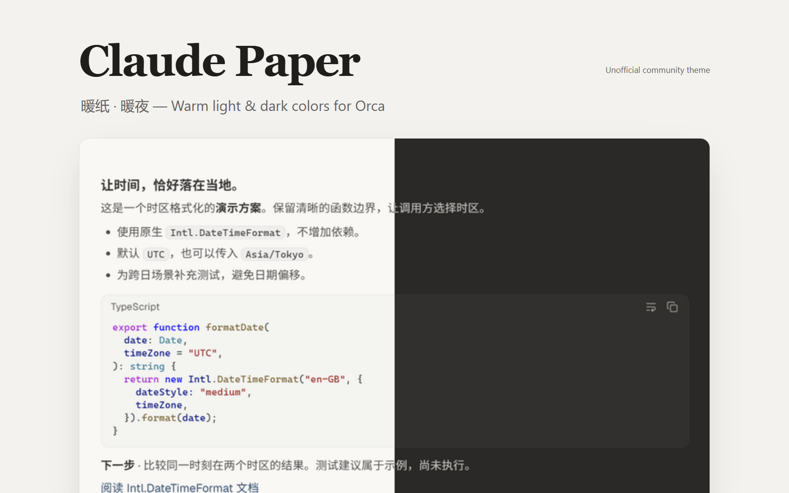
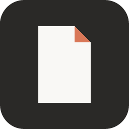
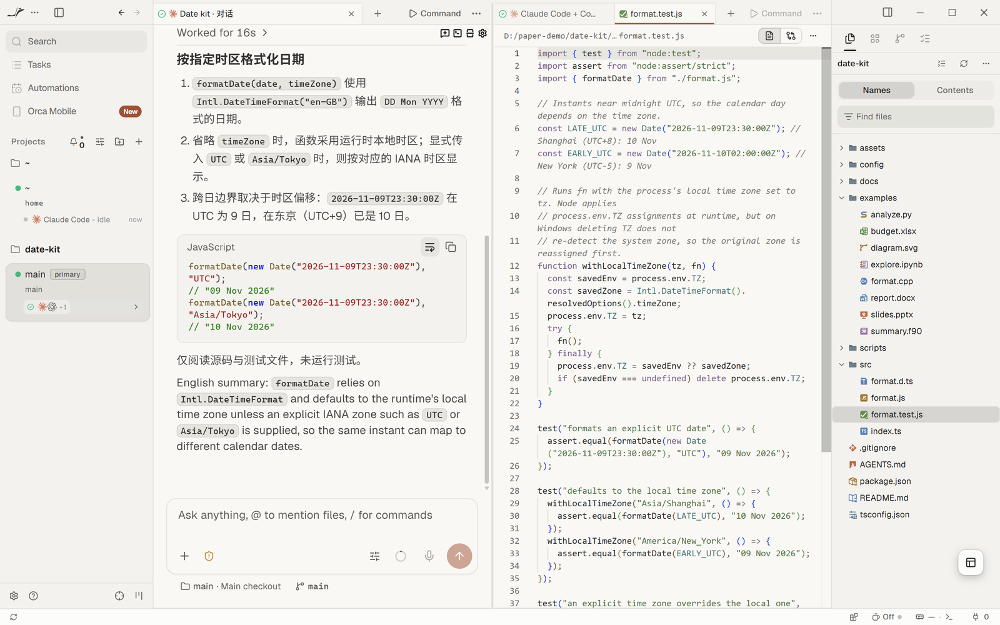
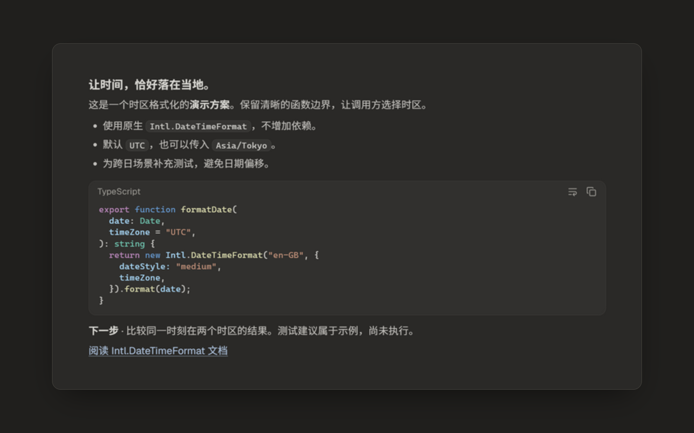
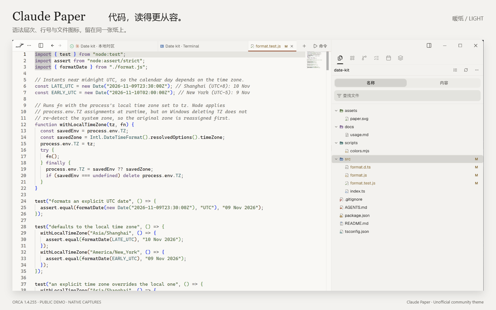
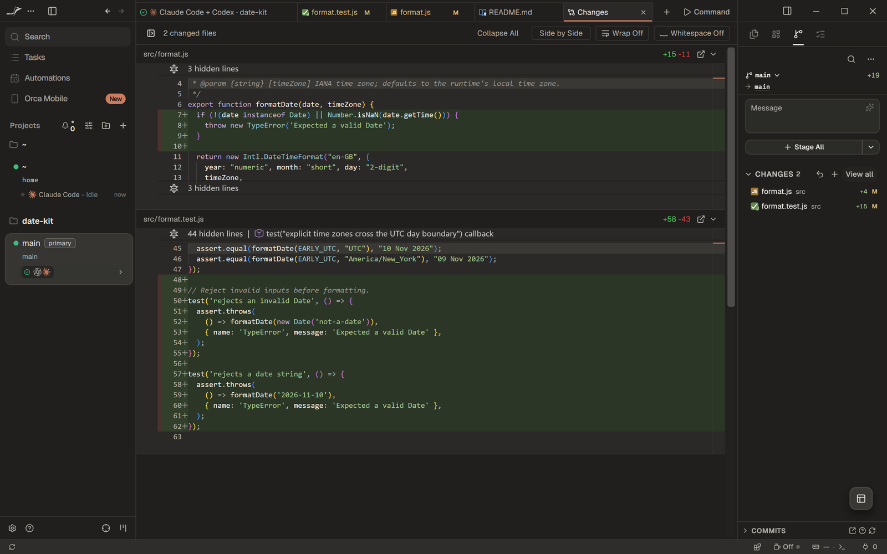
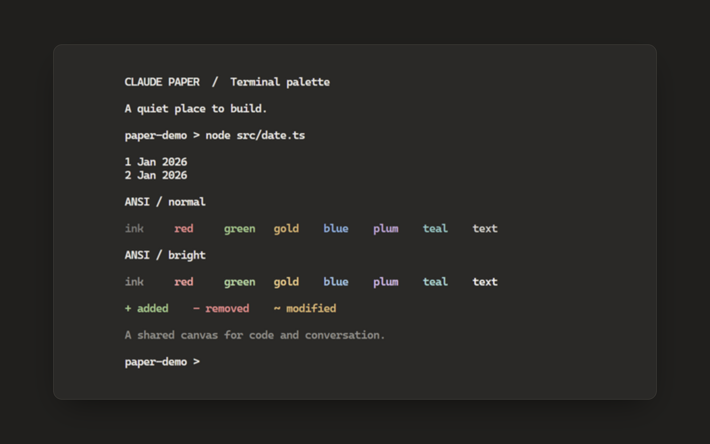
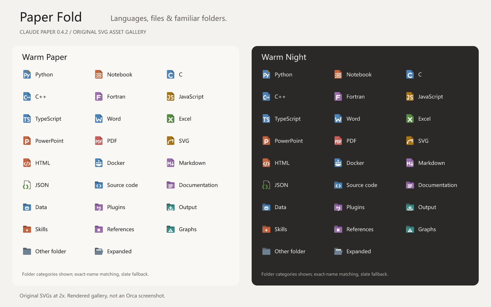
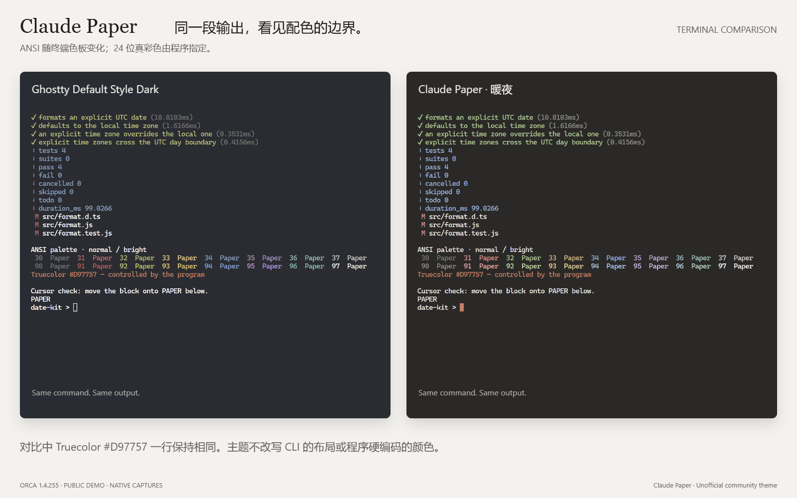

<p align="center"><a href="https://gongxliang.github.io/Claude-paper/"></a></p>
<p align="center"></p>
<h1 align="center">Claude Paper for Orca</h1>
<p align="center"><b>One paper. Two lights.</b><br>Warm light and charcoal dark for chat, code, terminal and the file tree.</p>
<p align="center"><b>English</b> · <a href="README.zh-CN.md">简体中文</a><br><a href="https://gongxliang.github.io/Claude-paper/">Explore the theme</a> · <a href="https://www.onorca.dev/plugins/gongxliang/claude-paper">Community store</a> · <a href="#install">Install</a></p>

A Claude-inspired palette for the places you work in Orca. Quiet paper surfaces, restrained terracotta actions and clear blue links, with original Paper Fold icons for documents, languages and common folders.

| Warm Paper & Warm Night | Paper Fold icons | Matching terminal palettes |
| --- | --- | --- |
| 2 app themes, 73 color tokens | 77 original SVGs, 512 mappings | 2 palettes with 16 ANSI colors |
| Chat, sidebars, editor and diffs | 16 folder categories, 118 exact names | Background, cursor, selection and text |

**0.4.2 · Free · MIT · Data only.** An unofficial community theme, not affiliated with or endorsed by Anthropic or Stably.

## Install

Requires **Orca 1.4.255+**. Use the [community store](https://www.onorca.dev/plugins/gongxliang/claude-paper), or run:

```sh
orca plugin install GongXLiang/Claude-paper --json
```

In **Settings → Appearance**, select:

1. **Claude Paper · 暖纸** (Warm Paper) for the light app theme and **Claude Paper · 暖夜** (Warm Night) for dark.
2. The matching terminal palettes, or the app theme's option to use its terminal palette.
3. **Claude Paper · 纸折图标** for file icons.

Turn off **Match Terminal Appearance** in chat settings to use the independent chat colors; when enabled, chat follows the selected terminal colors and font.

For Claude Code CLI, Orca also offers **Match Claude Code to Terminal Theme**. This optional host setting syncs colors to Claude Code's own interface; installing this plugin does not enable it. [Orca's implementation](https://github.com/stablyai/orca/blob/v1.4.255/src/main/claude/theme-sync/claude-code-theme.ts)

## Conversation, in context



<details><summary>View the same chat in Warm Night</summary>



</details>

## Code, changes and terminal output

| Warm Paper editor | Warm Night diff and tests |
| --- | --- |
| [](docs/assets/editor-light.png) | [](docs/assets/diff-dark.png) |

[Dark editor](docs/assets/editor-dark.png) · [Light diff](docs/assets/diff-light.png) · [Light terminal](docs/assets/terminal-light.png)



## Languages and files you can recognize

Python, Notebook, C, C++, Fortran, JavaScript and TypeScript have distinct symbols on colored folded-paper silhouettes. Word, Excel, PowerPoint, PDF, SVG, HTML and Docker also have their own marks.



The gallery is rendered directly from plugin SVGs, not an Orca screenshot. Exact filenames take priority over the longest matching suffix: for example, `format.test.js` gets a test icon and `types.d.ts` a declaration icon. Generic `.py`, `.ipynb`, `.c`, `.cpp`, `.f90` and `.js` files keep their language/type icons. [Full mappings](icons/theme.json)

| Language / type | Suffixes |
| --- | --- |
| Python | `.py`, `.pyi` |
| Notebook | `.ipynb`, `.qmd`, `.rmd` |
| C | `.c`, `.h` |
| C++ | `.cc`, `.cpp`, `.hpp`, `.cxx`, `.hxx` |
| Fortran | `.f`, `.for`, `.ftn`, `.f90`, `.f95`, `.f03`, `.f08`, `.f18` |
| JavaScript | `.js`, `.jsx`, `.mjs`, `.cjs` |
| TypeScript | `.ts`, `.tsx`, `.mts`, `.cts` |

## Common folders, clear matching rules

Folder categories describe purpose; the actual assignment uses **case-insensitive exact names**, as required by [Orca's icon interface](https://github.com/stablyai/orca/blob/v1.4.255/docs/reference/plugin-themes.md#icon-themes).

| Category | Example names — each is a separate alias |
| --- | --- |
| Source code | `src`, `source`, `code`, `modules`, `services` |
| Skills and agents | `skills`, `skill`, `.skills`, `agents`, `.codex`, `.claude` |
| Plugins | `plugins`, `plugin`, `extensions`, `extension`, `addons` |
| Data | `data`, `raw`, `dataset`, `datasets`, `database`, `db` |
| Output and reports | `output`, `outputs`, `result`, `results`, `reports`, `exports` |
| Documentation and references | `docs`, `documentation`, `examples`, `references`, `reference`, `bibliography` |
| Graphs and knowledge | `graph`, `graphs`, `knowledge`, `knowledge-base` |
| Assets and tools | `assets`, `images`, `resources`, `scripts`, `tools` |

Names such as `raw` and `data` match independently; they do not describe a two-level directory. There is no content detection, path matching, substring matching or parent inheritance. An unlisted folder such as `my-project-notes` uses the **slate fallback**, including its open state. `graphify` remains a compatibility alias, not a required project convention.

The full set includes tests, configuration, dependencies, build/cache and version control. [All 118 names by category](icons/folders.json) · [Visual matching guide](https://gongxliang.github.io/Claude-paper/#folders)

## A public example, in English and Chinese

The same small date-formatting task is documented in [English](examples/README.md) and [简体中文](examples/README.zh-CN.md), with runnable code and four tests. No private chats or project files are included.

> Let formatDate use the local time zone by default, while keeping an explicit time-zone argument. Add tests around midnight.

```js
import { formatDate } from './examples/date-kit/format.mjs';

const date = new Date('2026-11-09T23:30:00Z');
formatDate(date, 'UTC');            // 09 Nov 2026
formatDate(date, 'Asia/Shanghai');  // 10 Nov 2026
```

## What changes

| Area | Theme control |
| --- | --- |
| App, chat, editor and diffs | 73 color tokens and syntax colors |
| Files and folders | File types, exact folder names and fallback icons |
| Terminal | Foreground, background, cursor, selection and 16 ANSI colors |
| CLI 24-bit truecolor | Controlled by the CLI program; Orca's optional Claude Code sync is separate |
| Layout, fonts, corners, motion and button icons | Controlled by Orca and user settings |

[](docs/assets/cli-compare.png)

In this comparison, ANSI colors follow the palette while the explicit `Truecolor #D97757` line stays unchanged. These are terminal samples, not a Claude Code CLI screenshot.

## Media, development and credits

Native scene images use a public Chinese-language demo captured in Orca 1.4.255 / Claude Paper 0.3.0. App and terminal colors remain unchanged. English captions explain the scenes; screenshot text is preserved. The bilingual icon galleries show the current 0.4.2 assets. The origami orca identity was generated with GPT following an Opus 5.5 design consultation. [Media provenance](docs/MEDIA.md) · [Identity prompt](docs/IDENTITY.md)

[Development](DEVELOPMENT.md) · [Design history](DESIGN.md) · [Changelog](CHANGELOG.md) · [Releases](https://github.com/GongXLiang/Claude-paper/releases)

Visual research and presentation references: [open-claude-ui](https://github.com/Caho1/open-claude-ui), [HwFee DSH CDS](https://github.com/HwFee/HwFee-dsh), [Claude Theme for Orca](https://github.com/jiangwanyutao/orca-claude-theme), and [Monospace Icons for Orca](https://github.com/faisalmuhammad/orca-monospace-icons). Theme code, icon SVGs and page design are independently implemented; no third-party screenshots, SVGs or fonts were copied.

The community store indexes version tags asynchronously and may lag behind GitHub. [Check the listing](https://www.onorca.dev/plugins/gongxliang/claude-paper).
