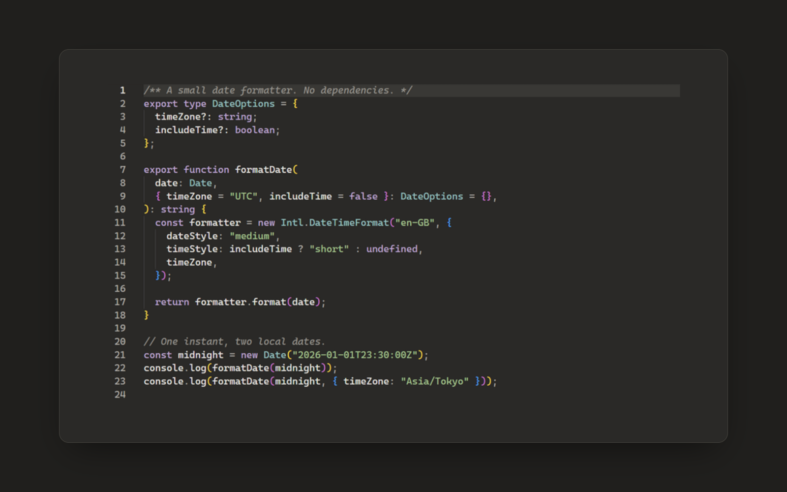
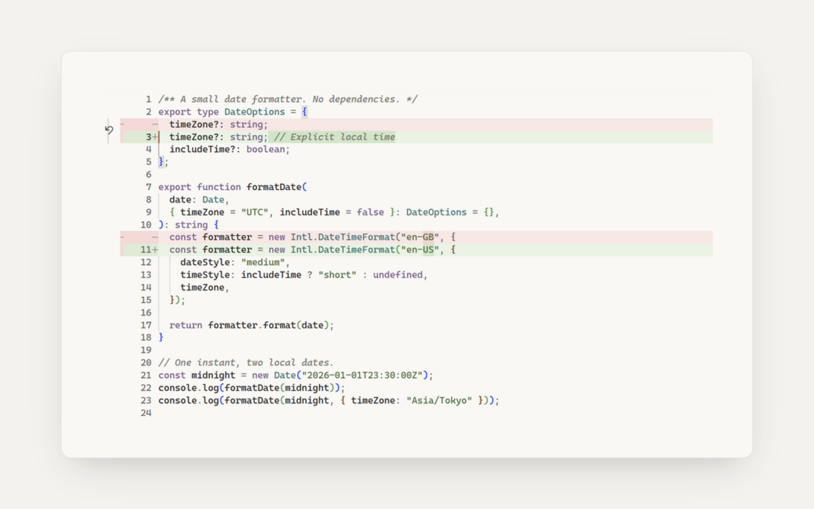
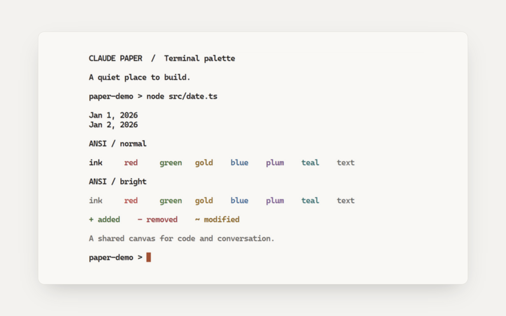

<p align="center">
  <a href="https://GongXLiang.github.io/Claude-paper/">
    
  </a>
</p>

<h1 align="center">Claude Paper for Orca</h1>
<p align="center"><b>一张纸，两种光。</b><br>Warm light &amp; dark colors for the app, native chat, editor and terminal.</p>
<p align="center"><a href="https://GongXLiang.github.io/Claude-paper/">交互效果展示</a> · <a href="https://www.onorca.dev/plugins/gongxliang/claude-paper">Orca 商店</a> · <a href="#安装">安装</a> · <a href="#english">English</a></p>

为 Orca 换上一张暖纸：中性暖白、暖炭灰、克制的陶土强调色，以及清晰的蓝色链接。两套应用主题与两套终端配色，覆盖从对话到代码的工作过程。

**非官方社区主题 · 免费 · MIT**。与 Anthropic 或 Stably 无隶属或背书关系。

## 安装

需要 **Orca 1.4.253 或更新版本**。

```sh
orca plugin install GongXLiang/Claude-paper --json
```

1. 打开 **设置 → 外观**，浅色主题选「Claude Paper · 暖纸」，深色主题选「Claude Paper · 暖夜」。
2. 终端主题分别选择同名配色。
3. 在 **设置 → 聊天界面** 中，关闭「匹配终端外观」可让聊天跟随应用主题；开启时，请同时选择匹配的终端配色。

## 暖纸与暖夜

同一段公开演示回复，在两种光线下的样子。暖白适合白天，暖炭灰适合夜晚；文字、列表、代码块和链接保留 Orca 原生呈现。

### 暖纸 · 原生聊天


### 暖夜 · 原生聊天


[在展示页拖动比较明暗 →](https://GongXLiang.github.io/Claude-paper/)

## 从代码到差异

紫色关键字、绿色字符串、青色类型；绿色新增与玫瑰色删除，让不同信息有自己的位置。





<details>
<summary>查看暖纸代码编辑器</summary>


</details>

## 命令行，也在同一张纸上

编辑器与终端使用协调的底色；两套终端主题均提供 normal / bright ANSI 配色。下图包含真实日期格式化输出与专门准备的色样。

| 暖纸 · Light terminal | 暖夜 · Dark terminal |
| --- | --- |
| [](docs/assets/terminal-light.png) | [](docs/assets/terminal-dark.png) |

**图片说明：**以上素材来自 Orca 1.4.253 中的公开演示内容，采用真实界面局部裁切、等比例放大和展示框排版。封面为同一聊天的明暗拼接；未重绘界面或替换截图中文字。公开素材不含个人聊天、项目列表、设备名、账号、用量或本机路径。字体、字号和代码块样式由 Orca 与使用者设置决定。

## 覆盖范围

- 两套应用主题，每套设置 66 个公开颜色令牌。
- 应用表面、侧栏、标签页、菜单、按钮、聊天与 Git/diff 配色。
- 编辑器语法高亮与两套匹配的终端 ANSI 颜色。
- 纯数据插件，无运行脚本、网络请求、后台进程或额外能力权限。

布局、字体、圆角、阴影、动效与工具卡片仍由 Orca 决定。展示网页中的交互与动效仅属于网页。

## 版本与维护

**0.2.1 是第二版配色的展示更新**：新增封面、场景图库、交互网页与商店媒体字段，主题颜色保持 0.2.0 原样。

[设计说明](DESIGN.md) · [开发与发布](DEVELOPMENT.md) · [素材说明](docs/MEDIA.md) · [更新记录](CHANGELOG.md) · [GitHub Releases](https://github.com/GongXLiang/Claude-paper/releases)

商店由 Orca 按版本标签自动索引，GitHub 发布与商店刷新可能不同步；以[商店页面](https://www.onorca.dev/plugins/gongxliang/claude-paper)实际显示为准。

## 卸载

在 **设置 → 插件** 找到 Claude Paper 并卸载。也可先运行 `orca plugin list --json` 查看确切插件标识，再运行：

```sh
orca plugin uninstall <pluginKey> --json
```

卸载前可先切换到其他应用和终端主题。

## 验证

0.2.0 在 Orca 1.4.253 上通过 `plugin validate`、`plugin check` 与 190 项独立对比度检查。两套模式均已查看实际聊天、设置、diff 与 ANSI 终端色样，浅色另检查了普通 JSON 编辑器。0.2.1 另采集并检查了两种模式的公开 TypeScript 编辑器与终端画面。未穷举所有语言与终端程序；具体配色验证范围见 [DESIGN.md](DESIGN.md)。

## 致谢

第二版的层次、品牌色与功能色分工参考 [open-claude-ui](https://github.com/Caho1/open-claude-ui) 的社区研究，具体颜色针对 Orca 独立调整；未引入其组件、CSS、字体或动效代码。

初版视觉方向参考 [HwFee 的 DSH CDS 主题](https://github.com/HwFee/HwFee-dsh/tree/master/plugins/cds-theme)，基于 [Orca 的公开主题接口](https://github.com/stablyai/orca/blob/v1.4.253/docs/reference/plugin-themes.md) 独立实现。本仓库未包含 DSH 的代码、字体资产或 Anthropic 商业字体。

## English

Claude Paper brings warm light and dark colors to Orca's application, native chat, editor and terminal. [Explore the interactive showcase](https://GongXLiang.github.io/Claude-paper/) or browse the screenshots above.

Requires **Orca >=1.4.253**. Run `orca plugin install GongXLiang/Claude-paper --json`, then select **Claude Paper · 暖纸** for the light app theme and **Claude Paper · 暖夜** for the dark app theme in Settings → Appearance. Select the matching terminal palettes separately.

The gallery shows **cropped, proportionally enlarged native Orca captures with public demo content**, placed in presentation frames. The cover combines light and dark versions of the same chat. No private conversations, account details or local paths appear in the published images.

This is a content-only color theme. Layouts, fonts, radii, animations and tool renderers remain controlled by Orca. Version 0.2.1 adds presentation assets; its theme palettes are identical to 0.2.0. Website interactions are separate from the installed theme.

Unofficial community project; not affiliated with or endorsed by Anthropic or Stably. Free under the [MIT license](LICENSE).
