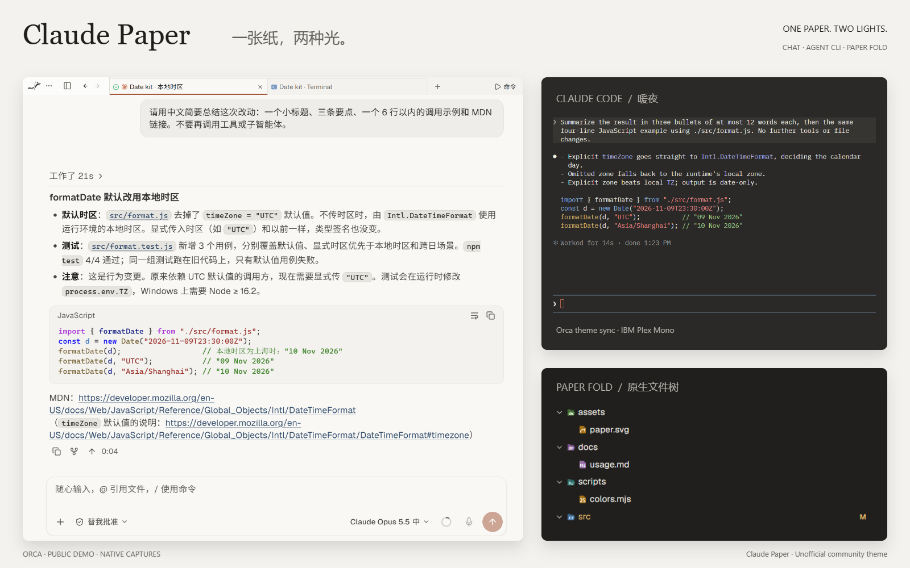
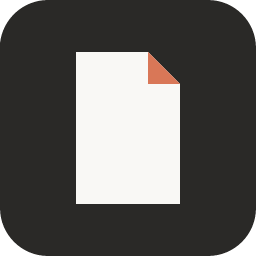
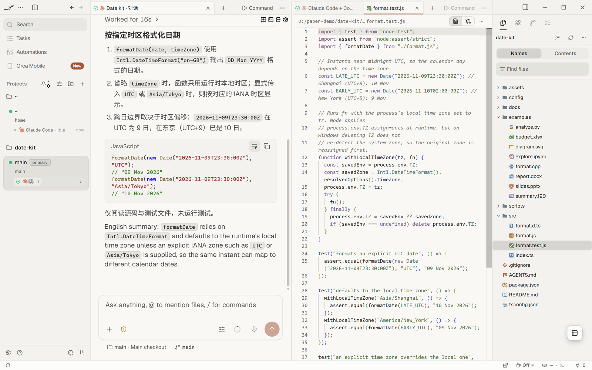
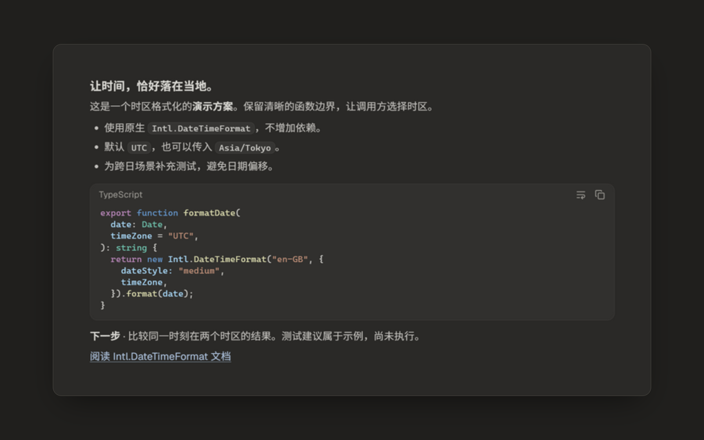
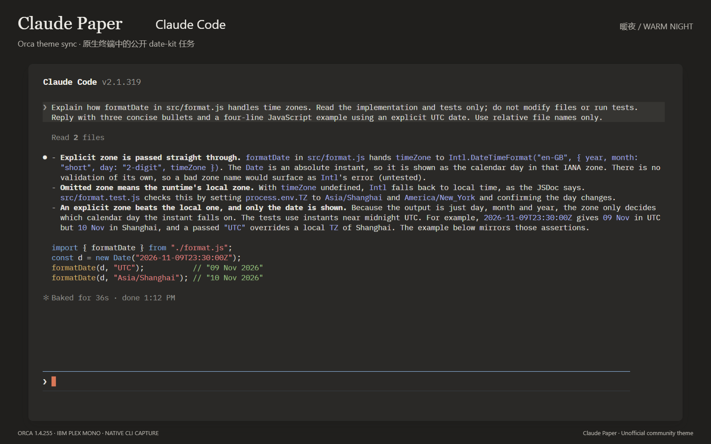
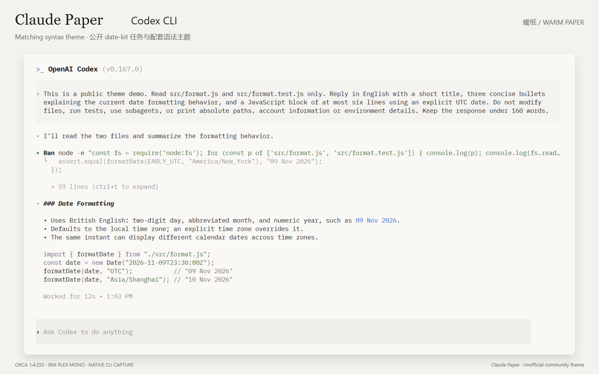
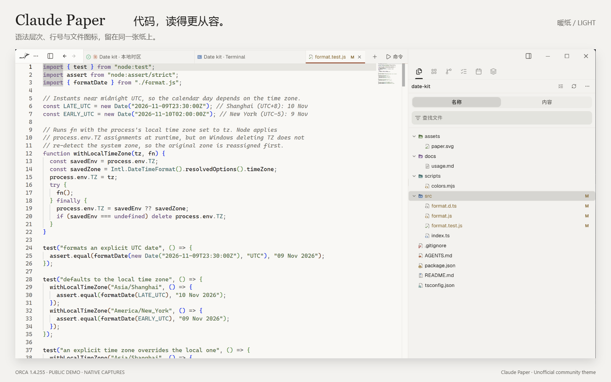
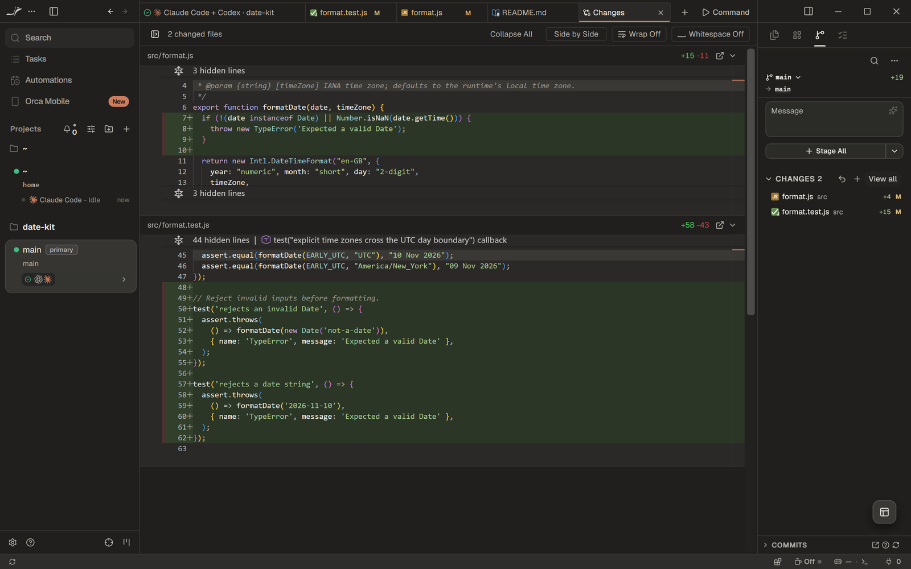
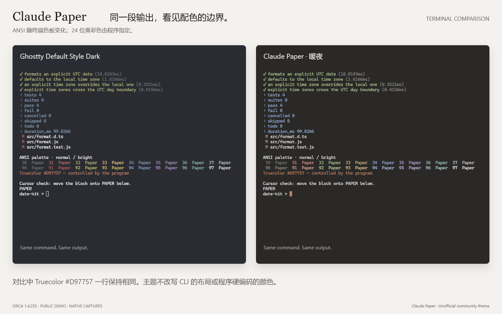

<p align="center"><a href="https://gongxliang.github.io/Claude-paper/zh-CN.html"></a></p>
<p align="center"></p>
<h1 align="center">Claude Paper for Orca</h1>
<p align="center"><b>一张纸，两种光。</b><br>为对话、代码、终端与文件树准备的暖纸与暖夜。</p>
<p align="center"><a href="README.md">English</a> · <b>简体中文</b><br><a href="https://gongxliang.github.io/Claude-paper/zh-CN.html">查看主题效果</a> · <a href="https://www.onorca.dev/plugins/gongxliang/claude-paper">社区商店</a> · <a href="#安装">安装</a></p>

让 Orca 更接近你喜欢的 Claude 质感。安静的纸色底面、克制的陶土强调与清楚的蓝色链接，搭配用于文档、编程语言和常见目录的原创纸折图标。

| 暖纸与暖夜 | 纸折图标 | 配套终端 |
| --- | --- | --- |
| 安静的 Chat、清晰的代码与差异 | 辨认语言、文档与工具 | Claude Code 同步 + 可选 Codex 语法主题 |
| 2 套应用主题，73 个色彩令牌 | 77 个 SVG、16 类目录、512 条映射 | 2 套终端色板 + 可选 IBM Plex Mono |

**0.5.0 · 免费 · MIT + OFL 字体 · 纯数据。** 非官方社区作品，与 Anthropic 或 Stably 无隶属或背书关系。

## 安装

需要 **Orca 1.4.255+**。可从[社区商店](https://www.onorca.dev/plugins/gongxliang/claude-paper)安装，或运行：

```sh
orca plugin install GongXLiang/Claude-paper --json
```

在 **设置 → 外观** 中选择：

1. 应用浅色主题为 **Claude Paper · 暖纸**，深色主题为 **Claude Paper · 暖夜**。
2. 终端主题选择同名配色，或使用应用主题下的「使用其终端配色」。
3. 文件图标主题为 **Claude Paper · 纸折图标**。

在聊天设置中关闭 **匹配终端外观**，可使用独立聊天细节色；开启时，聊天采用所选终端的颜色与字体。

使用 **Claude Code CLI** 时，在 **设置 → 外观** 搜索 Claude Code，开启 **Match Claude Code to Terminal Theme**。它会跟随 Orca 终端色板，在 Orca 外也生效；关闭后恢复原主题，在 Claude Code 内选择其他主题会停止同步。插件不会自动开启这项宿主功能。[Orca 实现说明](https://github.com/stablyai/orca/blob/v1.4.255/src/main/claude/theme-sync/claude-code-theme.ts)

使用 **Codex CLI** 时，可安装[配套语法主题](extras/codex/README.zh-CN.md)，再用 `/theme` 选择 `claude-paper-light` 或 `claude-paper-dark`。它们影响代码和差异语法，不会自动跟随 Orca 切换。终端换色后，运行中的 CLI 可能需要退出并恢复会话，才能重新识别底色。

新 CLI 截图使用可选的 **IBM Plex Mono**，可在终端或编辑器字体选择器手动选用。已有字体设置不会被自动替换；中文使用系统回退字体。[字体来源与 OFL 许可](fonts/README.md)

[宣传网页](https://gongxliang.github.io/Claude-paper/zh-CN.html#install)展示带来源日期的官方安装量，定期刷新；它表示安装次数，不是实时在线人数。

## 对话，保留完整场景



<details><summary>查看同一段暖夜对话</summary>



</details>

## 真实 Agent CLI，同一套色调

| Claude Code · 暖夜 | Codex CLI · 暖纸 |
| --- | --- |
| [](docs/assets/claude-dark.png) | [](docs/assets/codex-light.png) |

[暖纸 Claude Code](docs/assets/claude-light.png) · [暖夜 Codex](docs/assets/codex-dark.png)

画面来自读取公开 date-kit 示例的真实 CLI 会话，使用可选 IBM Plex Mono。标头、对话与输入框分别裁切以移除私人信息，没有重绘 CLI 界面或回复。

## 代码、改动与终端输出

| 暖纸编辑器 | 暖夜差异与测试 |
| --- | --- |
| [](docs/assets/editor-light.png) | [](docs/assets/diff-dark.png) |

[深色编辑器](docs/assets/editor-dark.png) · [浅色差异](docs/assets/diff-light.png) · [浅色终端](docs/assets/terminal-light.png)

[终端测试与 ANSI 色样](docs/assets/terminal-dark.png)

## 一眼辨认语言与文件

Python、Notebook、C、C++、Fortran、JavaScript 和 TypeScript 使用居中的独立符号与彩色折纸轮廓。Word、Excel、PPT、PDF、SVG、HTML、Docker 也各有自己的标记。


图鉴直接渲染插件 SVG，并非 Orca 窗口截图。具体文件名优先于最长后缀匹配，例如 `format.test.js` 使用测试图标，`types.d.ts` 使用类型声明图标；普通 `.py`、`.ipynb`、`.c`、`.cpp`、`.f90`、`.js` 文件使用各自的语言或类型图标。[完整映射](icons/theme.json)

| 语言或类型 | 后缀 |
| --- | --- |
| Python | `.py`、`.pyi` |
| Notebook | `.ipynb`、`.qmd`、`.rmd` |
| C | `.c`、`.h` |
| C++ | `.cc`、`.cpp`、`.hpp`、`.cxx`、`.hxx` |
| Fortran | `.f`、`.for`、`.ftn`、`.f90`、`.f95`、`.f03`、`.f08`、`.f18` |
| JavaScript | `.js`、`.jsx`、`.mjs`、`.cjs` |
| TypeScript | `.ts`、`.tsx`、`.mts`、`.cts` |

## 通用目录，明确的匹配规则

目录分类说明用途；实际分配遵循 [Orca 图标接口](https://github.com/stablyai/orca/blob/v1.4.255/docs/reference/plugin-themes.md#icon-themes)，按**名称精确匹配，不区分大小写**。

| 用途分类 | 名称示例，每一项都是独立别名 |
| --- | --- |
| 源代码 | `src`、`source`、`code`、`modules`、`services` |
| 技能与智能体 | `skills`、`skill`、`.skills`、`agents`、`.codex`、`.claude` |
| 插件 | `plugins`、`plugin`、`extensions`、`extension`、`addons` |
| 数据 | `data`、`raw`、`dataset`、`datasets`、`database`、`db` |
| 输出与报告 | `output`、`outputs`、`result`、`results`、`reports`、`exports` |
| 文档与参考资料 | `docs`、`documentation`、`examples`、`references`、`reference`、`bibliography` |
| 图谱与知识 | `graph`、`graphs`、`knowledge`、`knowledge-base` |
| 素材与工具 | `assets`、`images`、`resources`、`scripts`、`tools` |

`raw` 和 `data` 可分别匹配，不表示二级目录。宿主不识别目录内容、不按路径或部分名称匹配，也不继承父目录图标。`my-project-notes` 等未收录名称使用**灰蓝色默认文件夹**，并有展开状态。`graphify` 只是保留的兼容别名，不是要求所有人遵循的项目规范。

完整分类还包括测试、配置、依赖、构建缓存和版本控制。[全部 118 个名称](icons/folders.json) · [可视化匹配说明](https://gongxliang.github.io/Claude-paper/zh-CN.html#folders)

## 公开示例，中英双语

同一个日期格式化任务提供[中文指南](examples/README.zh-CN.md)与 [English](examples/README.md)，包含可运行代码和四项测试，不包含私人聊天或项目文件。

> 让 formatDate 默认使用本地时区，同时保留显式时区参数，并补充跨午夜的测试。

```js
import { formatDate } from './examples/date-kit/format.mjs';

const date = new Date('2026-11-09T23:30:00Z');
formatDate(date, 'UTC');            // 09 Nov 2026
formatDate(date, 'Asia/Shanghai');  // 10 Nov 2026
```

## 主题能改变什么

| 范围 | 主题作用 |
| --- | --- |
| 应用、聊天、编辑器与差异 | 73 个色彩令牌与语法配色 |
| 文件与目录 | 文件类型、精确目录名称和兜底图标 |
| 终端 | 前景、背景、光标、选区与 16 色 ANSI |
| CLI 的 24 位真彩色 | 由 CLI 程序控制；Orca 可选的 Claude Code 同步是另一项宿主功能 |
| Codex CLI 配套主题 | 可选代码块与差异语法配色，需要单独安装 |
| 字体 | 提供可选 IBM Plex Mono，由用户在 Orca 中选择 |
| 布局、圆角、应用动效与设置开关 | 由 Orca 与用户设置决定 |

[](docs/assets/cli-compare.png)

对照中 ANSI 颜色跟随色板，显式指定的 `Truecolor #D97757` 保持不变。这些是终端色样，并非 Claude Code CLI 的界面截图。

## 素材、开发与致谢

聊天、编辑器与差异沿用已经过隐私审阅的 Orca 1.4.255 / Claude Paper 0.3.0 实机图，配色未改变。0.5.0 封面加入当前文件树与真实 Claude Code；新 CLI 图片分别来自 Claude Code 2.1.319、Codex CLI 0.167.0。图标图鉴继续使用未改变的 0.4.2 SVG；折纸虎鲸标识由 Opus 5.5 提供设计咨询，再经 GPT 生图生成。[素材记录](docs/MEDIA.md) · [标识提示词](docs/IDENTITY.md)

[开发说明](DEVELOPMENT.md) · [设计历史](DESIGN.md) · [更新记录](CHANGELOG.md) · [版本下载](https://github.com/GongXLiang/Claude-paper/releases)

视觉研究与展示参考：[open-claude-ui](https://github.com/Caho1/open-claude-ui)、[HwFee DSH CDS](https://github.com/HwFee/HwFee-dsh)、[Claude Theme for Orca](https://github.com/jiangwanyutao/orca-claude-theme)、[Monospace Icons for Orca](https://github.com/faisalmuhammad/orca-monospace-icons)。主题代码、SVG 图标和页面独立实现，未复制第三方截图或 SVG。IBM Plex Mono 保持原文件，按原始 [OFL 许可](fonts/OFL.txt)分发。

社区商店按版本标签异步索引，可能晚于 GitHub。[查看收录状态](https://www.onorca.dev/plugins/gongxliang/claude-paper)。
