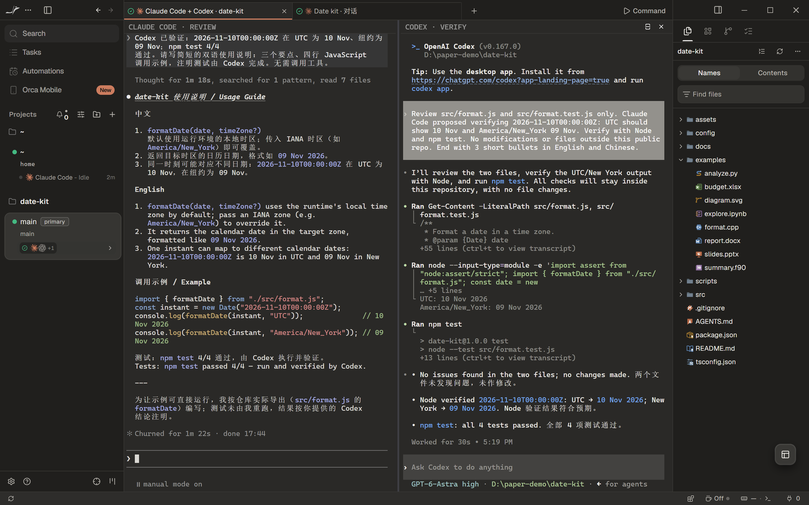
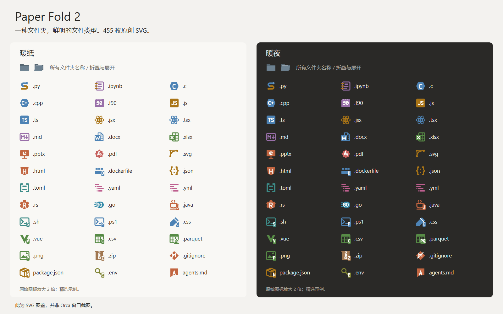

# Claude Paper for Orca

白天是暖纸，夜晚是柔和的炭灰。让 Chat、智能体终端和文件树拥有协调的视觉感受。

[English](README.md) · **简体中文** · [在线预览](https://gongxliang.github.io/Claude-paper/zh-CN.html) · [Orca 社区商店](https://www.onorca.dev/plugins/gongxliang/claude-paper)


两套应用主题、配套终端色板、**455 枚原创文件图标**、统一的灰蓝文件夹，以及可选 IBM Plex Mono 字体。非官方社区主题，纯数据插件，无需额外能力权限。

## 安装

需要 **Orca 1.4.255 或更新版本**。从[社区商店](https://www.onorca.dev/plugins/gongxliang/claude-paper)安装，或运行：

```sh
orca plugin install GongXLiang/Claude-paper --json
```

在**设置 → 外观**选择浅色 **Claude Paper · 暖纸**、深色 **Claude Paper · 暖夜**、对应终端色板，以及 **Claude Paper · 纸折图标**。IBM Plex Mono 可在终端或编辑器字体选择器中手动选择；已有字体设置不会被插件覆盖。

若要使用图中的独立 Chat 配色，请关闭 **Match Terminal Appearance / 匹配终端外观**；喜欢对话跟随终端颜色和字体时也可以开启。

[展示网页](https://gongxliang.github.io/Claude-paper/zh-CN.html#install)提供官方安装量和来源日期。数据定期刷新，表示安装次数，不是实时活跃用户或独立人数。

## 对话，始终在工作区之中

[](docs/assets/chat-light-large.png)

[查看暖夜](docs/assets/chat-dark-large.png)。每个场景都保留完整 Orca 窗口；点击图片可打开 **2880 × 1800** 原始分辨率大图。

## 两个智能体，一个 Orca 窗口

[](docs/assets/agents-dark-large.png)

[同一工作区的暖纸效果](docs/assets/agents-light-large.png)。

这是实际运行的 Claude Code 和 Codex CLI：前者审阅日期工具，后者检查跨日边界并运行测试，再将验证结果交回 Claude Code。截图展示真实公开任务的完成状态，没有重绘终端。编排能力来自 Orca 和智能体；主题负责让它们的视觉环境更加协调。

- **Claude Code：**可在 Orca 外观设置开启 **Match Claude Code to Terminal Theme**。这是宿主的可选同步功能，会跟随 Orca 终端色板，也可能影响 Orca 外运行的 Claude Code；在 Claude Code 中另选主题会停止同步。安装本插件不会自动开启它。[宿主实现](https://github.com/stablyai/orca/blob/v1.4.255/src/main/claude/theme-sync/claude-code-theme.ts)
- **Codex CLI：**另提供[可选配套语法主题](extras/codex/README.md)，通过 `/theme` 选择 `claude-paper-light` 或 `claude-paper-dark`，影响代码和差异高亮，不会自动随 Orca 明暗切换。终端背景变化后，运行中的 CLI 可能需要重新启动或恢复会话。
- **字体：**可选 IBM Plex Mono，中文使用系统后备字体。[来源与 OFL 许可](fonts/README.md)

## 文件夹安静，文件有个性

所有文件夹统一使用**灰蓝色**，仅区分折叠与展开。无论叫 `skills`、`src`，还是 `my-notes`，效果都一致，不再用大量目录颜色干扰文件识别。



上图直接渲染插件的 SVG。**340 个后缀 + 115 个固定文件名**各有独立 SVG；用轮廓识别类别，再用色彩和小标记区分格式、变体。Python 双蛇、Notebook 单元格、C/C++ 六边形、Office、Markdown、JSON 花括号、YAML 缩进线、TOML 方括号、Git、Docker、Shell、数据库和媒体文件均已覆盖。常见配置文件包括 `.gitignore`、`.env`、`package.json`、`Dockerfile`、`Cargo.toml` 和 `pyproject.toml`。

[查看全部 455 条对应关系](icons/COVERAGE.md) · [机器可读清单](icons/catalogue.json) · [原生 Orca 文件树](docs/assets/files-dark-large.png)

Orca **先匹配完整文件名，再匹配最长后缀**，不区分大小写。因此 `format.test.js` 使用测试图标，`types.d.ts` 使用声明图标，普通 `.js`、`.ts` 使用对应语言图标。`.yaml` / `.yml` 等近似格式保留共同轮廓，但小标记不同。未列出的类型仍有中性文件图标；这是一套广泛覆盖的精选分类，并不宣称识别所有可能存在的后缀。含义有歧义的后缀选择见覆盖说明。

## 代码与改动，保留完整上下文

| 暖纸 · 编辑器 | 暖夜 · 差异审阅 |
| --- | --- |
| [](docs/assets/editor-light-large.png) | [](docs/assets/diff-dark-large.png) |

[深色编辑器](docs/assets/editor-dark-large.png) · [浅色差异](docs/assets/diff-light-large.png) · [暖纸文件浏览](docs/assets/files-light-large.png)

## 主题能改变什么

| 区域 | 范围 |
| --- | --- |
| 应用、Chat、编辑器、差异 | 73 个受支持颜色令牌及编辑器语法色 |
| 文件与文件夹 | 455 枚文件图标、中性兜底、统一文件夹状态；共 458 条映射 |
| 终端 | 前景、背景、光标、选区、16 色 ANSI 色板 |
| CLI 真彩色 | CLI 显式输出的 24 位颜色仍由程序决定；宿主同步和 CLI 配套主题是独立选项 |
| 字体 | 可选 IBM Plex Mono，手动选择 |
| 布局、应用动效、设置开关、智能体编排 | 由 Orca 和用户设置决定 |

网页中的纸张动效用于产品展示，不会加入 Orca 应用界面。网页尊重“减少动态效果”；触屏设备使用普通滚动，同时保留场景按钮和键盘翻页。

## 一个公开任务，中英两种表达

[English walkthrough](examples/README.md) · [中文示例](examples/README.zh-CN.md)

> 默认使用本地时区，并保留显式时区参数。 / Use the local time zone by default; retain an explicit time-zone argument.

```js
import { formatDate } from './examples/date-kit/format.mjs';
const date = new Date('2026-11-09T23:30:00Z');
formatDate(date, 'UTC');            // 09 Nov 2026
formatDate(date, 'Asia/Shanghai');  // 10 Nov 2026
```

本版全部场景在 Orca 1.4.255 的独立公开演示配置中重新拍摄。不包含个人聊天、账户、设备名称、额度或私人项目。图中 `D:/paper-demo/date-kit` 是专门创建的公开演示路径。[拍摄记录](docs/MEDIA.md)

## 开发与致谢

[维护说明](DEVELOPMENT.md) · [设计历史](DESIGN.md) · [更新日志](CHANGELOG.md) · [版本下载](https://github.com/GongXLiang/Claude-paper/releases)

主题代码与文件 SVG 独立制作。研究参考：[open-claude-ui](https://github.com/Caho1/open-claude-ui)、[HwFee DSH CDS](https://github.com/HwFee/HwFee-dsh)、[Claude Theme for Orca](https://github.com/jiangwanyutao/orca-claude-theme)、[Monospace Icons](https://github.com/faisalmuhammad/orca-monospace-icons)、[Orca Material Icons](https://github.com/stablyai/orca-plugins/tree/main/plugins/material-icons)、[ThreeUI](https://github.com/MengTo/threeui)、[oil-ui](https://github.com/oil-oil/oil-ui)。没有复制其截图或 SVG。折纸虎鲸标识使用 GPT 生成图片，见[标识来源](docs/IDENTITY.md)。

插件代码使用 MIT 许可；IBM Plex Mono 保留 OFL 许可；网页的 GSAP/ScrollTrigger 使用[独立许可说明](docs/vendor/NOTICE.txt)。本项目与 Anthropic、Stably 无隶属或官方背书关系。社区目录异步扫描版本标签，更新可能晚于 GitHub。
